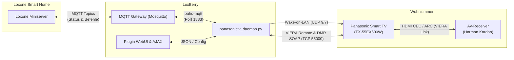

# LoxBerry Plugin für Panasonic Smart TVs (VIERA)

<p align="center">
  
</p>

<p align="center">
  <strong>Vollständige bidirektionale Integration von Panasonic Viera Smart TVs in den Loxone Miniserver über das LoxBerry MQTT Gateway.</strong>
</p>

<p align="center">
  
  
  
  
  
</p>

---

## 📺 Überblick

Dieses LoxBerry-Plugin ermöglicht die vollständige Überwachung und Steuerung von **Panasonic Smart TVs** (z. B. der Serien **EX, DX, FX, GX, HX, JZ, LZ** wie dem beliebten *TX-55EX600W*). Es ersetzt bestehende Brücken (wie Home Assistant) durch eine direkte, ressourcenschonende und native Anbindung an LoxBerry und den Loxone Miniserver.

Alle Zustände (Einschaltzustand, Lautstärke, Mute, Erreichbarkeit) werden in Echtzeit an das **LoxBerry MQTT Gateway** übertragen. Befehle vom Miniserver (Einschalten via Wake-on-LAN, Tasten, HDMI-Umschaltung oder automatisierte Audio-Makros) werden sofort ausgeführt.

---

## ✨ Highlights & Funktionen

* 🔍 **Automatische Netzwerk-Erkennung (SSDP / UPnP Discovery):**
  * Findet Panasonic TVs im lokalen Netzwerk auf Knopfdruck.
  * Ermittelt Modellbezeichnung, IP-Adresse und liest die **MAC-Adresse** für Wake-on-LAN automatisch aus der ARP-Tabelle aus.
* ⚡ **Zuverlässiges Einschalten (Wake-on-LAN):**
  * Panasonic Fernseher schalten im Standby den Netzwerk-Steuerport (55000) ab. Das Plugin weckt den TV automatisch über ein gezieltes UDP-WOL-Paket.
* 🔊 **Audioausgabe-Umschaltung (Heimkino vs. TV-Lautsprecher):**
  * Behebt das bekannte Problem, dass Panasonic TVs bei externen AV-Receivern (z. B. **Harman Kardon**, Denon, Yamaha) unerwünscht auf die internen TV-Lautsprecher umschalten.
  * Per Knopfdruck oder via MQTT (`panasonictv/set/audio_output: home_theater`) wird über ein automatisiertes **VIERA Link Makro** sekundenschnell auf den Receiver umgeschaltet.
* 🔄 **Echte 2-Wege MQTT-Integration:**
  * Automatische Erkennung der Zugangsdaten des LoxBerry MQTT Brokers (`general.json`).
  * Publish mit Retain-Flag für sofortigen Status im Miniserver nach einem Neustart.
  * LWT (Last Will & Testament) zur Überwachung der Dienst-Verfügbarkeit.
* 🎮 **Moderne Live-WebUI & Fernbedienung:**
  * Gestaltet nach dem **LoxBerry Design System** (responsive, mobilfähig, ohne jQuery Mobile).
  * Virtuelles Steuerkreuz, Ziffern- und Funktionstasten für Live-Tests direkt im Browser.
* 📄 **Integrierter Log-Viewer & Diagnose:**
  * Live-Log mit Auto-Refresh, Ein-Klick-Kopieren in die Zwischenablage (auch über unverschlüsseltes HTTP) und Dateidownload.
  * Verknüpfung in den systemweiten LoxBerry Log-Manager.

---

## 🏗️ Systemarchitektur



---

## 📋 Voraussetzungen am Fernseher

Damit der Panasonic TV über das Netzwerk gesteuert und eingeschaltet werden kann, müssen im Menü des Fernsehers folgende Punkte aktiviert sein:

1. **Menü &rarr; Netzwerk &rarr; Verbindung-Einstellungen &rarr; Netzschnittstelle:** Vorzugsweise **Kabel (LAN)** oder stabiles WLAN.
2. **Menü &rarr; Netzwerk &rarr; Netzwerk-Link-Einstellungen:**
   * **VIERA Remote:** `Ein`
   * **Apps Steuerung / DLNA:** `Ein`
   * **Einschalten per Netzwerk / Network Standby:** `Ein` *(zwingend erforderlich für Wake-on-LAN)*
   * **DMR / Digital Media Renderer:** `Ein` *(erforderlich für Lautstärke- & Mute-Rückmeldung)*

---

## 🚀 Installation

1. Lade die aktuelle Datei [**`LoxBerry-Plugin-PanasonicTV.zip`**](https://github.com/challo2018/LoxBerry-Plugin-PanasonicTV/releases) herunter.
2. Öffne die LoxBerry Weboberfläche &rarr; **Plugin-Verwaltung**.
3. Wähle das ZIP-Archiv aus und klicke auf **Installieren**.
4. Das Installationsskript (`postinstall.sh`) richtet automatisch ein isoliertes Python-Virtual-Environment (`venv`) ein und installiert die benötigten Bibliotheken (`panasonic-viera`, `paho-mqtt`).
5. Nach der Installation öffnest du das Plugin:
   * Klicke auf **„🔍 Netzwerk nach Fernsehern scannen“**.
   * Wähle deinen TV aus dem Dropdown aus und klicke auf **„✔ Daten übernehmen“**.
   * Klicke auf **„💾 Einstellungen speichern“**. Der Hintergrunddienst startet automatisch.

---

## 📡 MQTT Topic-Referenz

Das Standard-Topic-Präfix lautet `panasonictv` (kann in den Einstellungen angepasst werden).

### Status (vom Plugin gesendet & retained)

| Topic | Typ / Werte | Beschreibung |
|:---|:---|:---|
| `panasonictv/status/online` | `true` / `false` | Gibt an, ob der Fernseher eingeschaltet und im Netzwerk erreichbar ist. |
| `panasonictv/status/power` | `ON` / `OFF` | Einschaltstatus für einfache Verknüpfung mit Schaltern / Visualisierung. |
| `panasonictv/status/volume` | `0` – `100` | Aktuelle Master-Lautstärke des Fernsehers. |
| `panasonictv/status/mute` | `true` / `false` | Gibt an, ob der TV stummgeschaltet ist. |
| `panasonictv/status/daemon` | `online` / `offline` | Status des Plugin-Hintergrunddienstes (MQTT LWT). |
| `panasonictv/status/json` | JSON Object | Kompletter Zustand (z. B. `{"online":true,"power":"ON","volume":18,"mute":false}`). |

### Befehle (an das Plugin gesendet)

| Topic | Mögliche Werte | Beschreibung |
|:---|:---|:---|
| `panasonictv/set/power` | `ON`, `1`, `TRUE` | Weckt den Fernseher via Wake-on-LAN auf. |
| | `OFF`, `0`, `FALSE` | Schaltet den Fernseher in den Standby. |
| | `TOGGLE` | Schaltet den TV je nach aktuellem Zustand ein oder aus. |
| `panasonictv/set/volume` | `0` – `100` | Setzt die absolute Lautstärke (z. B. `25`). |
| | `+1`, `+5`, `-5` | Erhöht oder verringert die Lautstärke relativ. |
| | `UP`, `DOWN` | Simuliert die Tasten Lauter / Leiser der Fernbedienung. |
| `panasonictv/set/mute` | `true`, `1`, `on` | Schaltet den Ton stumm. |
| | `false`, `0`, `off` | Hebt die Stummschaltung auf. |
| | `toggle` | Schaltet den Mute-Status um. |
| `panasonictv/set/audio_output` | `home_theater` | Führt das VIERA Link Makro zur Umschaltung auf den AV-Receiver aus. |
| | `tv` | Schaltet die Tonausgabe zurück auf die internen TV-Lautsprecher. |
| `panasonictv/set/key` | Tastenname *(siehe unten)* | Sendet einen beliebigen Fernbedienungscode (z. B. `MUTE`, `HOME`, `HDMI1`). |
| `panasonictv/set/wol` | `1` | Sendet ein gezieltes Wake-on-LAN Magic-Packet an die konfigurierte MAC-Adresse. |

---

## 🎛️ Loxone Config Einbindung

### 1. Virtuelle Eingänge (Status empfangen)
Lege für jeden gewünschten Wert einen **Virtuellen Eingang** in Loxone Config an:

* **TV Ein/Aus:**
  * Name: `TV Power`
  * Validierung als Digitaler Eingang
  * In LoxBerry MQTT Gateway als Topic abonnieren: `panasonictv/status/power` (Text `ON` &rarr; Wert `1`, Text `OFF` &rarr; Wert `0`).
* **TV Lautstärke:**
  * Name: `TV Lautstärke`
  * Analoger Eingang
  * Topic: `panasonictv/status/volume`

### 2. Virtuelle Ausgänge (Steuern über MQTT)
Erstelle einen **Virtuellen Ausgang** mit der IP deines LoxBerry MQTT Brokers:
* Adresse: `http://loxberry:1883` oder über das LoxBerry MQTT Gateway.

Lege darunter **Virtuelle Ausgangsbefehle** an:
* **Fernseher Einschalten:**
  * Befehl bei EIN: `panasonictv/set/power ON`
* **Fernseher Ausschalten:**
  * Befehl bei EIN: `panasonictv/set/power OFF`
* **Audio auf Heimkino umschalten:**
  * Befehl bei EIN: `panasonictv/set/audio_output home_theater`
* **Audio auf TV-Lautsprecher umschalten:**
  * Befehl bei EIN: `panasonictv/set/audio_output tv`
* **Eingang HDMI 1 wählen:**
  * Befehl bei EIN: `panasonictv/set/key HDMI1`

---

## ⌨️ Unterstützte Tasten (Keys)

Über das Topic `panasonictv/set/key` können alle gängigen Tasten übermittelt werden:

| Kurzname | Interner NRC-Code | Funktion |
|:---|:---|:---|
| `POWER` | `NRC_POWER-ONOFF` | Power-Taste (Standby Toggle) |
| `MUTE` | `NRC_MUTE-ONOFF` | Stummschaltung |
| `VOLUP` | `NRC_VOLUP-ONOFF` | Lautstärke erhöhen |
| `VOLDOWN` | `NRC_VOLDOWN-ONOFF` | Lautstärke verringern |
| `UP` / `DOWN` / `LEFT` / `RIGHT` | `NRC_UP-ONOFF` etc. | Navigation im Menü |
| `ENTER` | `NRC_ENTER-ONOFF` | OK / Bestätigen |
| `RETURN` / `BACK` | `NRC_RETURN-ONOFF` | Zurück |
| `HOME` | `NRC_HOME-ONOFF` | Smart-TV Home-Bildschirm |
| `MENU` | `NRC_MENU-ONOFF` | Hauptmenü |
| `EXIT` / `CANCEL` | `NRC_CANCEL-ONOFF` | Menü verlassen |
| `VIERA_LINK` | `NRC_VIERA_LINK-ONOFF` | VIERA Link Menü öffnen |
| `HDMI1`, `HDMI2`, `HDMI3`, `HDMI4` | `NRC_HDMI1-ONOFF` etc. | Direkt auf entsprechenden HDMI-Eingang schalten |
| `RED`, `GREEN`, `YELLOW`, `BLUE` | `NRC_RED-ONOFF` etc. | Farbtasten (Videotext / HbbTV) |

---

## ❓ Häufige Fragen & Troubleshooting

<details>
<summary><strong>Der Fernseher lässt sich im Standby nicht einschalten</strong></summary>

1. Prüfe, ob im Menü des TV unter *Netzwerk &rarr; Netzwerk-Link-Einstellungen* die Option **Einschalten per Netzwerk** aktiviert ist.
2. Überprüfe die hinterlegte **MAC-Adresse** in den Plugin-Einstellungen. Die MAC-Adresse muss exakt der LAN-Schnittstelle deines TV entsprechen.
3. Manche Panasonic TVs schalten nach längerer Standby-Zeit das WLAN-Modul stromlos. Eine Kabelverbindung (Ethernet LAN) wird dringend empfohlen.
</details>

<details>
<summary><strong>Lautstärke und Mute zeigen „-“ oder keine Werte an</strong></summary>

1. Vergewissere dich, dass am TV unter *Netzwerk-Link-Einstellungen* der Punkt **DLNA / DMR (Digital Media Renderer)** auf `Ein` steht. Über diese UPnP-Schnittstelle liest das Plugin die Audiopegel aus.
2. Ältere Modelle oder bestimmte HDMI-ARC-Modi regeln die Lautstärke direkt am externen AV-Receiver; in diesem Fall blockiert der TV zeitweise SOAP-Abfragen.
</details>

<details>
<summary><strong>Wird ein PIN-Code zur Kopplung benötigt?</strong></summary>

Die meisten Panasonic-Geräte vor 2018 (einschließlich der Serie EX600 wie *TX-55EX600W*) benötigen **keinen PIN-Code**. Das Plugin steuert diese Geräte direkt ohne Authentifizierung. Für neuere OLED- oder LCD-Modelle ab ca. 2018/2019 bietet das Plugin eine integrierte PIN-Pairing-Schaltfläche im Webfrontend.
</details>

<details>
<summary><strong>Wo finde ich die Logdateien?</strong></summary>

Die Logdatei kann direkt in der WebUI im Reiter **„Logdatei & Diagnose“** eingesehen, aktualisiert, kopiert oder heruntergeladen werden. Auf der LoxBerry-Konsole liegt das Log unter:
```bash
/opt/loxberry/log/plugins/panasonictv/daemon.log
```
</details>

---

## 👨‍💻 Entwickler & Danksagung

* **Autor & Maintainer:** Fabian Franzmann ([@challo2018](https://github.com/challo2018))
* **Entwickelt für:** [LoxBerry](https://wiki.loxberry.de)

---

## 📄 Lizenz & Verwendete Bibliotheken

Dieses Plugin ist unter der **Apache License 2.0** lizenziert – siehe die [`LICENSE`](LICENSE)-Datei für den vollständigen Lizenztext.

### Verwendete Drittanbieter-Bibliotheken:

| Bibliothek | Autor / Organisation | Lizenz | Beschreibung / Verwendung |
|:---|:---|:---|:---|
| [**`panasonic-viera`**](https://github.com/florianholzapfel/panasonic-viera) | Florian Holzapfel | **MIT License** | Python-Bibliothek zur IP-Steuerung von Panasonic Viera TVs via SOAP und VIERA Remote Protocol |
| [**`paho-mqtt`**](https://github.com/eclipse-paho/paho.mqtt.python) | Eclipse Foundation | **EPL 2.0 / EDL 1.0** | MQTT-Client für Python zur Anbindung an den Broker |
| [**`LoxBerry SDK / phplib`**](https://github.com/mschlenstedt/Loxberry) | Michael Schlenstedt & Team | **Apache 2.0** | LoxBerry PHP- und System-Bibliotheken (`loxberry_web.php`, `loxberry_io.php`, `loxberry_system.php`, `loxberry_log.php`) |
